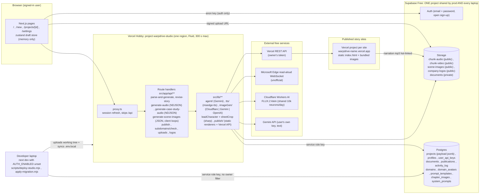
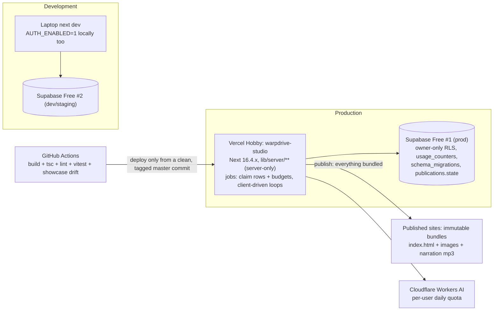

# 03 Architecture and deploy-readiness audit: Story Site Generator

| | |
|---|---|
| Date | 04 Nov 2026 |
| Code audited | `master` HEAD `71ac7d0` (the next deploy candidate) |
| Live today | `9953fe6` (local branch `live-08-oct-2026`, deployed 08 Oct 2026) at https://warpdrive-studio.vercel.app |
| Owner constraint | Everything stays on free tiers (Vercel Hobby, Supabase Free, Cloudflare Workers Free, Gemini free text, Edge read-aloud) |
| Scope | Module boundaries, data model and migrations, long-running work, state, storage, publish and build pipelines, config, errors and observability, environments, tests, lint, dependencies, free-tier limits, scalability, deploy checklist |

## 0. What was verified, and how

**Run on this machine (Node 24.21.0, macOS, no `.env.local`):**

| Check | Result |
|---|---|
| `npm run build` | **Pass** (exit 0). Next 16.3.3 (Turbopack), 26 static pages, 27 API routes, proxy. No env-related failure: every env read is lazy (inside handlers), so a build without `.env.local` succeeds. |
| `npx tsc --noEmit` (after the build) | **Pass** (exit 0, no output). |
| `npm run lint` | **Fail** (exit 1): 1,901 problems, 22 errors, 1,879 warnings. 9 errors and 1,875 warnings come from the generated bundle `public/themes/showcase/showcase.js`, which the ESLint config does not ignore. The other 13 errors are the legacy files HANDOFF already lists (`AudioPlayer`, `ThemeProvider`, `AvatarDisplay`, `avatar-3d`, `lunar-gravity-card`, `reactive-mouth-overlay`, `case-study-preview`). |
| `npm outdated` | 22 packages behind; notable: `next` 16.3.3 to 16.4.5, `@google/genai` 2.19.0 to 2.32.0, `msedge-tts` 2.0.8 to 2.1.1, `@supabase/supabase-js` 2.117.2 to 2.118.0. Majors available but not urgent: `typescript` 7, `eslint` 10, `@types/node` 26. |
| `npm audit --omit=dev` | **4 vulnerabilities (1 critical, 3 high)**: `next` 16.0.0 to 16.4.0 (critical: several RCE, cache-poisoning and Server Actions DoS advisories), `sharp` < 0.35.5 (librsvg CVE), `follow-redirects`, `source-map-js`. |
| Showcase bundle drift | Rebuilt `showcase.js` with the same esbuild options into the scratchpad: **byte-identical** to the committed `public/themes/showcase/showcase.js`. No drift today. None of the 25 source inputs of the bundle changed between live and master. (A throw-away copy of the build script sat in the repo root for the duration of one command so esbuild could resolve `node_modules`, then was deleted.) |
| Migration 005 dependency | Code-read plus `git grep`: master degrades gracefully without 005 (details in section 4). Live code (`9953fe6`) references none of the 005 objects, and no query in either version uses `select("*")`, so 005 is additive and safe in either order. |

**Read only (not executed):** every finding below that names a runtime behaviour (timeouts, races, RLS exposure, free-tier exhaustion) comes from reading code, SQL and docs. Nothing was called on Supabase, Vercel, Gemini or Cloudflare; the production database policies, buckets, env vars and Vercel project limits were **not** inspected live. Items marked "verify live" need a check in the dashboards.

No source file, config, `.env.local`, migration or deployment was changed. The only new file is this document.

---

## 1. Current architecture

**Request flow of the long jobs:**

| Job | Route | Shape | Resumable? |
|---|---|---|---|
| Story generation | `POST /api/parse-and-generate` | One JSON response; parse document, 1 Gemini call with a 2-model x 2-attempt cascade | No (draft held in browser memory until saved) |
| Narration | `POST /api/projects/[id]/generate-audio` (+ case-study twin) | NDJSON stream; 4 TTS calls in flight; payload saved after each chunk by `progressSaver` | Partly: `onlyMissing` rerun, but the client does not rerun on its own |
| Scene images | `POST /api/projects/[id]/generate-scene-images` | JSON; 235 s budget; per-chapter claim rows in `chapter_images`; client loops while `remaining > 0` | Yes (claim + stale-pending after 6 min) |
| Publish | `POST /api/projects/[id]/publish` | JSON; render HTML, download images, upload every file to Vercel, poll READY for up to 60 s | No (status can stick at `publishing`) |

---

## 2. Findings

Severity: Critical = fix before shipping master; High = fix before or right after shipping; Medium = plan it; Low = tidy-up. Effort: S (under half a day), M (1 to 3 days), L (more).

| ID | Sev. | Area | Where (`file:line`) | Problem | Recommendation | Effort |
|---|---|---|---|---|---|---|
| AR-01 | Critical | Dependencies / security | `package.json:23` (`next` 16.3.3); `src/lib/leadCharacter.ts:119`, `src/lib/sheetCrop.ts:67`, `src/lib/imageGen/cloudflare.ts:52` (`sharp`) | `npm audit`: `next` 16.3.3 is inside the range of a critical advisory set (RCE in Image Optimization with SVG, RCE in `use cache`, Server Actions DoS; the app has a public server action in `src/app/projects/[id]/preview/actions.ts`). `sharp` < 0.35.5 carries a librsvg CVE, and the app feeds **user-uploaded SVG logos** to `sharp(..., { density: 300 })`. Live is exposed too. | Bump `next` and `eslint-config-next` to 16.4.5 (free), add `sharp@^0.35.5` as a direct dependency, run `npm audit fix` for the two transitive ones, rebuild, retest. | S |
| AR-02 | High | Data model / security (verify live) | `db/schema.sql:134-140` | `projects` RLS policies are `using (owner_id is null or auth.uid() = owner_id)` for **select and all**. The anon key is public in the browser bundle, so anyone can read, insert, update or delete rows with `owner_id is null` straight through PostgREST (the 3 legacy projects at least), bypassing every API check. | Replace both policies with owner-only (`auth.uid() = owner_id`, plus `with check`), assign the legacy rows to the owner (SQL in `002_accounts.sql` comment), then confirm in the dashboard that anon has no write path. Ship as migration 006. | S |
| AR-03 | High | Cost / abuse on free tiers | `src/lib/imageGen/types.ts:43`; `src/app/api/projects/[id]/publish/route.ts:394`; `src/components/SceneImagesPanel.tsx:163-169`; no allowlist in `src/lib/auth/**` | Sign-up is open and email confirmation is off (HANDOFF section 2), yet two resources are **shared and owner-funded by quota**: the single Cloudflare pool (10,000 neurons/day, about 8 stories) and the owner's Vercel token (one new Vercel project per publish). There is no per-user quota, no rate limit anywhere, and Showcase projects auto-start image generation on open. One stranger, or one curious colleague, can drain the day's images or fill the Vercel account. | Turn off public sign-ups in Supabase (invite-only) or enforce an email-domain allowlist server-side; add a per-user daily image counter (a small `usage_counters` table checked in the scene-image route); cap publishes per user per day; make auto-start opt-in once the pool is low. All free. | S-M |
| AR-04 | High | Environments | `HANDOFF.md:78`; `src/lib/auth/session.ts:59-64`; `src/lib/activity.ts:34`; every route's `if (user) q = q.eq("owner_id", ...)` | Local dev and production share one Supabase database and storage. Locally `AUTH_ENABLED` is unset, so `requireUser()` returns null, every owner filter is skipped and `logActivity` is a no-op: a laptop can list, edit, regenerate or delete **any** user's project with the service-role key and leaves no audit trail. Migrations are first run on production. | Create a second **free** Supabase project as dev/staging (the Free plan allows two active projects), apply `schema.sql` + 002 to 005 there, point `.env.local` at it, and keep production secrets only in Vercel. Optionally a Vercel Preview env pointed at the dev project. | M |
| AR-05 | High | Publish / storage coupling | `src/lib/publish/staticSite.ts:59-71`, `src/lib/publish/showcaseSite.ts:41`, `src/app/api/projects/[id]/generate-audio/route.ts:110-115` | Published sites are not self-contained: narration is hot-linked from the public `chunk-audio` bucket at deterministic paths (`<projectId>/<chunkId>.mp3`, `upsert: true`). Regenerating audio silently changes a live site's narration (and can mismatch its text); deleting a project breaks its site; every listen counts against Supabase Free egress (5 GB/month); a paused Supabase project (Free pauses after a week without activity) takes every site's audio down. Images are already bundled; audio is the odd one out. | Bundle the mp3 files into the Vercel deployment like scene images (`bundleSceneImages` pattern). Sites become immutable snapshots and Supabase egress stops scaling with visitors. Deploy size grows by roughly 0.36 MB per minute of narration, fine on Hobby. | M |
| AR-06 | High | Image pipeline (master) | `src/lib/leadCharacter.ts:277-288`; stored prompts in `db/migrations/004_lead_character_prompts.sql` | The single-image lead path builds its prompt from `lead_character_rules` (3,269 chars) + `lead_scene_image` (1,377) + outfit (220-460) + logo line: **about 5,000 characters**, while FLUX.2 klein reads about 1,900. Only the sheet path has a length guard (`SHEET_PROMPT_MAX_CHARS`, line 355). Without 005 every Cloudflare image takes the single path; with 005, leftovers (1-3 per story) and every "Regenerate" still do. Result: identity and logo text truncated, and 4x the neurons per chapter. | Apply 005 before setting the Cloudflare credentials in production. Then add a compact single-image prompt for Cloudflare (a `lead_single_compact` row in a migration 006) or reuse the sheet rules with the existing truncation helper when the provider is Cloudflare. | M |
| AR-07 | High | Testing / CI | repository root (no `*.test.*`, no `.github/`) | No automated tests and no CI. Safety rests on a manual `tsc` + `build`. Several pure, high-value units are untested: `sheetCrop.ts` (gutter detection), `chunkMerge.ts`, `contentVersion.ts`, `subdomain.ts`, `userKeys.ts` (AES-GCM), `fillPrompt`, `truncateAtBoundary`, `renumberImageMentions`, `runWithinBudget`. `leadCharacter.ts` already exposes test hooks that nothing calls. | Add Vitest (free) with unit tests for the list above (a fixture 2x2 sheet image for `sheetCrop`), and a GitHub Actions workflow running `npm ci`, build, `tsc`, lint (after AR-21), tests and the showcase drift check (AR-22). Free minutes cover this easily. | M |
| AR-08 | High | Deploy pipeline | `scripts/deploy-studio.mjs:24-32, 53-72, 74-116` | The deploy uploads the **working tree**, not a commit: uncommitted or unpushed edits ship silently, and nothing records which SHA is live (today that is only a local branch name). It copies production secrets from the laptop's `.env.local` into Production **and Preview**, never removes stale vars, and stores the deploying token as the app's publishing token. Rollback is manual in the Vercel dashboard. | Refuse to run unless the tree is clean and on `master` matching `origin/master`; build the file list from `git ls-files` (or `git archive HEAD`); send `meta: { gitCommitSha }` with the deployment and tag the commit `deploy-dd-MMM-yyyy`; target Production only; print the previous production deployment id for Instant Rollback; use a dedicated publishing token separate from the deploy token. | S |
| AR-09 | Medium | Concurrency / data integrity | `src/app/api/projects/[id]/generate-audio/route.ts:78-92, 140-142`; same pattern in `generate-case-study-audio`; `src/app/api/projects/[id]/route.ts:217` | `projects.payload` is one jsonb document written whole, last writer wins. The narration progress saver writes `buildPayload(project-snapshot, currentChunks)`, so a text edit saved via `PATCH` (or a case-study-audio run) while narration is generating is overwritten. Publish already re-reads the payload; the generators do not. | Optimistic concurrency: add `version int` (or use `updated_at`) and update `... where version = :read`, re-reading and re-merging on conflict; or move per-chunk audio fields into a narrow update (Postgres function doing `jsonb_set` on one chunk). | M |
| AR-10 | Medium | Long-running work | `src/lib/readNdjsonStream.ts:13-28`; `src/components/PublishDialog.tsx:250-268`; `src/app/projects/[id]/page.tsx:604-620` | If Vercel stops `generate-audio` at 300 s the stream simply ends. The reader returns normally without a `done` message, `failures` stays undefined, and the Publish dialog goes on to publish with narration missing. `generate-audio` has no time budget of its own (unlike scene images). | Treat a stream without a terminal `done`/`error` as a failure; loop on the client with `onlyMissing: true` until nothing is missing (the scene-image panel pattern); add a 240 s budget in the route that stops starting new chunks and returns `remaining`. | S |
| AR-11 | Medium | Long-running work | `src/app/api/projects/[id]/generate-scene-images/route.ts:257-293`; `src/lib/sceneImages.ts:221-236` | The 235 s budget is only checked **between** units. A sheet batch whose director fails falls back to four single images inside the same unit (up to 4 x (45 s director + 150 s image)), so the function can be killed at 300 s: the client gets a 504, and the claimed rows stay `pending` until the 6-minute stale window passes. | Pass a deadline into each unit; check it before every single-image fallback and release unclaimed chapters (set them back to their previous status) instead of starting them. | S-M |
| AR-12 | Medium | Publish pipeline | `src/app/api/projects/[id]/publish/route.ts:295`; `src/lib/publish/vercel.ts:202, 228-253` | Status is set to `publishing` before work and only reset in the `catch`, so a killed function leaves it stuck. File uploads run in an unbounded `Promise.all` with no timeout or retry (the deploy script has both); READY polling gives up after 60 s and then returns the non-aliased URL. Double-clicks can start two deployments. | Bounded upload concurrency (4-6) with `withRetry` and `AbortSignal.timeout`; record each attempt in `publications` with a state; treat `publishing` older than 6 minutes as failed in the UI; disable the button server-side with a claim like `chapter_images`. | S |
| AR-13 | Medium | Hosting model / free tier (verify live) | `src/lib/publish/vercel.ts:195-226`; `src/app/api/projects/[id]/route.ts:276-321` | One Vercel project per published site under the owner's Hobby account. Hobby caps projects and deployments per day (verify current numbers on the Vercel limits page) and is non-commercial only, while the product is used to pitch companies. Deleting a project never deletes or flags its Vercel project, so orphaned sites accumulate. | Short term: on project delete, delete (or at least list) the `warpdrive-<name>` Vercel project; show the count in Settings. Target: see section 3 (single static host for all sites). | M |
| AR-14 | Medium | Storage hygiene | `src/app/api/projects/[id]/route.ts:297-305` | Delete cleans only `chunk-audio` and `chunk-video`, and `storage.list()` returns at most 100 objects by default, so long projects leave files behind. `scene-images/<projectId>/*`, the source document in `documents` and the logo in `company-logos` are never removed. Supabase Free storage is 1 GB. | Page through `list()` (limit + offset), add `scene-images` and the project's `documents` rows, and remove the logo when no other project uses it. A weekly orphan sweep script is a cheap safety net. | S |
| AR-15 | Medium | AI integration | `src/lib/agent/generateStory.ts:6, 361-400`; `src/lib/agent/bindCaseStudyLayout.ts:10`; `src/lib/imageGen/constants.ts:37-42` | Gemini calls have no request timeout, retry every error (including 400/401/403 that will never succeed), and the model list is copied in three places; `GEMINI_TEXT_MODEL` only affects the scene director. A slow model can consume the whole 300 s of `parse-and-generate`. | One `geminiText()` helper in `src/lib/ai/` with a per-call timeout, retry only on 429/5xx/network, and a single model list honouring `GEMINI_TEXT_MODEL`. | S |
| AR-16 | Medium | Observability | 66 `console.*` calls across `src/`; `src/lib/activity.ts:34` | Logging is unstructured `console.*` only; Vercel Hobby keeps runtime logs only briefly, yet the HANDOFF test plan relies on reading `generate-scene-images (sheet): ... confidence` log lines. No request id, no error table, no health endpoint; `activity_log` is silent whenever auth is off. | Persist outcomes where they matter: sheet confidence and prompt length into `chapter_images` (or `activity_log.details`, which already carries `sheets`/`lowConfidenceSheets`); add a tiny `log()` helper emitting JSON with route, projectId and a request id; add `GET /api/health` reporting which integrations are configured (names only, never values). | M |
| AR-17 | Medium | Module boundaries | `src/app/api/subdomains/availability.ts`, `src/app/api/logos/server.ts`, `src/app/api/uploads/shared.ts` (imported by `publish/route.ts:29`, `projects/[id]/route.ts:21`, `src/components/LogoUpload.tsx`, `src/app/new/page.tsx`); `src/lib/publish/staticSite.ts:12` and `voyageSite.ts:19` import from `src/components/templates/storyMedia`; `src/lib/auth/UserMenuDropdown.tsx`; `AUDIO_BUCKET` redeclared in 5 routes; `assetBaseUrl` in `publish/route.ts:42` and `leadCharacter.ts:51`; `src/app/projects/[id]/page.tsx` 1,454 lines with 39 `useState` | Server logic lives under `app/api`, client components import from `app/api`, `lib` imports from `components`, and constants are duplicated. Nothing marks server-only modules, so a client import of a service-role module would only fail at runtime. | Move shared server code to `src/lib/server/**` with `import "server-only"`; move `storyMedia` to `src/lib/render/`; put every bucket name in `storageUrls.ts`; split the project page into panels (voice, images, publish) with one small zustand store for the server project. | M |
| AR-18 | Medium | Migrations | `db/schema.sql`; `db/migrations/*.sql`; `scripts/apply-migration.mjs` | No record of which migrations ran (only the HANDOFF table), applied by hand to production through the Management API, 004/005 overwrite tuned prompts when re-run, base schema mixes DDL and seeds, no down scripts. `system_prompts` is used, `agents`/`skills` tables are unused. | Adopt Supabase CLI migrations (free) or add a `schema_migrations` table that `apply-migration.mjs` writes and checks; split seeds from DDL; make prompt seeds `on conflict do nothing` and ship prompt changes as new versioned rows. | M |
| AR-19 | Medium | TTS dependency | `src/lib/tts/edge.ts`; `docs/DEPLOYMENT.md` section 8 | Narration depends on the unofficial Edge read-aloud WebSocket from Vercel IPs: no SLA, can rate-limit or change protocol without notice. It is the only working provider in production. | Keep it (free), but add a `/api/health` probe (AR-16), pin and watch `msedge-tts` (2.1.1 is out), and keep the `server` provider documented as the fallback. Bundling audio into sites (AR-05) at least protects what is already published. | S |
| AR-20 | Medium | Dependencies | `src/lib/sheetCrop.ts:64-67`; `src/lib/imageGen/cloudflare.ts:52-59` | Contact-sheet cropping and reference downscaling need `sharp`, which is not a declared dependency (it arrives as an optional dependency of `next`). If it is missing, cropping fails and `cloudflare.ts` silently sends full-size references that the API rejects (it wants under 512 px). | Declare `sharp` explicitly (same change as AR-01) and fail loudly at startup or in `/api/health` when it cannot load. | S |
| AR-21 | Low | Lint debt | `eslint.config.mjs:9-15` | `npm run lint` exits 1, so it cannot be a gate. 1,875 of 1,879 warnings and 9 of 22 errors come from the generated `public/themes/showcase/showcase.js`. | Add `public/themes/**` to `globalIgnores`; fix or file-disable the 13 legacy errors; then make lint part of CI. | S |
| AR-22 | Low | Build pipeline | `scripts/build-showcase.mjs`; `HANDOFF.md:80` | The committed Showcase bundle matches its sources today (verified byte-identical), but only a human remembering `npm run build:showcase` keeps it so. | CI step: run `build:showcase` and `git diff --exit-code public/themes/showcase`. | S |
| AR-23 | Low | State management | `src/lib/store.ts:23-160` | The draft store is memory-only: a generated storyline (a Gemini call on the user's quota) is lost on refresh or tab close until "save". | Save the project as a `draft` row right after generation, or persist the draft in `sessionStorage`. | S |
| AR-24 | Low | Dead or unreachable features | `src/lib/wav2lip.ts:1-10`; `src/app/projects/[id]/page.tsx:634`; `src/app/settings/**` (image provider) | The Wav2Lip avatar-video button calls a route that defaults to `http://localhost:5060`, unreachable from Vercel. With Cloudflare configured, the Settings image-provider choice and image keys are ignored. `three`/`@react-three/*` are used (Lunar hero, 3D avatar), so not unused, but they are the heaviest client dependencies. | Hide the Wav2Lip control when `WAV2LIP_SERVER_URL` is unset; show "Images: Cloudflare (shared)" in Settings when it overrides; lazy-load the 3D components with `next/dynamic`. | S |
| AR-25 | Low | Scalability | `src/app/api/projects/route.ts:44-50`; `src/lib/projects.ts:5-6` | The library list selects every project with its full `payload` jsonb, no pagination. Fine at tens of projects, slow at hundreds. | Select summary columns for the list (title, status, dates, counts) and paginate with `range()`. | S |
| AR-26 | Low | Config and docs | `src/lib/db.ts`, `src/lib/auth/config.ts`, `package.json` (no `engines`); `docs/DEPLOYMENT.md:33-37, 80` vs `HANDOFF.md:46, 216` | Env vars are read ad hoc with no startup validation; no `engines` (Node 24 used, `@types/node` 20); the server action `resolvePreviewAvatars` has no auth check (returns public data only). DEPLOYMENT.md still describes a Git-import deploy and "Confirm email on", HANDOFF says API upload and confirmation off. | `src/lib/env.ts` validating required vars per feature (used by `/api/health`); add `"engines": { "node": ">=22" }`; align DEPLOYMENT.md with the real process. | S |

---

## 3. Target architecture (free tier only)

The aim is not new vendors but fewer shared, mutable things: immutable published sites, a separate dev database, resumable jobs, and quotas on the shared pools.

1. **Two Supabase projects (both Free).** `dev` for laptops and preview deployments, `prod` only reachable from Vercel. Migrations go dev first, then prod, tracked in `schema_migrations` (AR-04, AR-18). Note the Free pause rule: keep prod active (it is used daily) and accept that dev may pause.
2. **Self-contained published sites.** Bundle narration mp3s with the deployment (AR-05). Supabase then only serves the studio app, so its storage and egress no longer grow with site visitors.
3. **Jobs as resumable steps, not long requests.** Keep Vercel request handlers, but give every long route the scene-image shape: claim rows, a time budget, `remaining` in the response, and a client loop that resumes. Apply it to narration (AR-10) and publish (AR-12). No queue service is needed; Supabase rows are the queue.
4. **Quotas and access on shared pools.** Invite-only accounts, a `usage_counters` table (per user per UTC day for images and publishes), and server-side checks before calling Cloudflare or Vercel (AR-03).
5. **Hosting of story sites.** Stay on per-site Vercel projects for now (it gives the `warpdrive-<name>.vercel.app` names the owner wants), but delete them on project delete and watch the count (AR-13). If the Hobby project or fair-use limits bite, the free fallback is a **single** static project that serves every site from a path (`/s/<name>/`), on Vercel Hobby or Cloudflare Pages; it trades the per-site hostname for no per-site project. A custom wildcard domain would keep hostnames but costs money, so it is out of scope.
6. **Layering.** `src/lib/server/**` (server-only: db, storage, ai, tts, publish), `src/lib/shared/**` (pure, testable: chunk merge, fingerprints, prompt filling, sheet maths), `src/components/**` (UI only). Route handlers become thin: parse, authorise, call a service, shape the response (AR-17).
7. **Observability without paid tools.** Structured JSON logs, outcomes persisted in the database rows that already exist (`chapter_images`, `publications`, `activity_log`), and `/api/health`. A free error tracker can be added later if the owner agrees, but it is not required.
8. **Quality gates.** Vitest + GitHub Actions on every push; the deploy script deploys only a clean, tagged commit that passed CI (AR-07, AR-08, AR-21, AR-22).

---

## 4. Migration 005 and master: what depends on what

| Question | Answer (code-read, `git grep` verified) |
|---|---|
| Does master need 005 to run? | **No.** `loadSheetPrompts()` (`src/lib/leadCharacter.ts:380-387`) returns null when any `lead_sheet_*` row is missing (`getPrompt` returns null for a missing row and for a missing table); the route then logs `sheet prompts (migration 005) are missing, drawing one image per chapter` (`generate-scene-images/route.ts:196-198`) and uses the single-image path. `loadSheetOutfit()` (lines 390-400) is only called when the sheet prompts exist, and never throws even if `domains.outfit_sheet` is absent. No other master code reads 005 objects. |
| What breaks if master ships before 005? | Nothing crashes. Contact sheets are simply off. **But** if `CLOUDFLARE_ACCOUNT_ID`/`CLOUDFLARE_API_TOKEN` are also set, every Showcase image goes through the single path with about 5,000-character prompts against a model that reads about 1,900 (AR-06): weaker identity and logo fidelity, and about 4x the neurons per chapter from the shared daily pool. Without Cloudflare credentials, image behaviour is the same as live (Gemini images fail with 429 on free keys). |
| Is 005 safe for the live code (`9953fe6`)? | Yes. Live references none of `outfit_sheet` or `lead_sheet_*`, and nothing selects `*`, so the added column and rows are invisible to it. 005 can be applied before or after the deploy. |
| Re-run risk | 005 overwrites the four `lead_sheet_*` bodies and all `domains.outfit_sheet` values on every run. Run it once. |
| Recommended order | 1) bump dependencies and redeploy (AR-01); 2) apply 005; 3) set the Cloudflare credentials; 4) run the one test story HANDOFF describes. If Cloudflare is not ready yet, master can ship without it and without 005. |

---

## 5. Free-tier limits and where this app hits them first

Numbers are the published free-tier limits as remembered at the time of writing; **verify each on the provider's pricing page** before relying on them.

| Service | Limit that matters | Where the app hits it | First to break |
|---|---|---|---|
| Vercel Hobby | 300 s per function (Fluid); 4.5 MB request body; non-commercial use only; caps on projects and deployments per day; short runtime-log retention | Narration of very long stories (about 60 characters of speech per second per call, 4 in flight); publish of bundles with avatar models (13 MB) and videos (11 MB) in `public/`; one project per site | Narration of more than about 60,000 characters in one run (DEPLOYMENT.md section 6) |
| Supabase Free | 500 MB database; 1 GB storage; 5 GB egress per month; 50,000 MAU; pauses after about a week of inactivity; 2 active projects | Audio (about 0.36 MB per narrated minute) and images in storage; **published sites streaming audio from Storage** (AR-05); no cleanup of images and documents (AR-14) | Egress, once a few published sites are actually listened to |
| Cloudflare Workers AI Free | 10,000 neurons per day per account, shared by all users, reset 00:00 UTC | About 115 neurons per single image, about 330 per sheet: roughly 8 stories a day with sheets, about 2-3 without 005 | Any day with more than a handful of Showcase stories (AR-03, AR-06) |
| Gemini free text | Per-key RPM/RPD limits; `gemini-flash-latest` often answers 503 | Story generation, case-study binding, scene director (bring-your-own-key, so per user) | Busy hours: the cascade helps, but no timeout (AR-15) |
| Edge read-aloud | Unofficial, no SLA | All narration | Unpredictable (AR-19) |

**Scalability summary:** the app is sized for a handful of internal users. The binding constraints, in order: the shared Cloudflare image pool, Supabase egress caused by hot-linked audio, the 300 s request ceiling for large narration runs, and Vercel Hobby's per-site project model. None needs a paid plan if AR-03, AR-05, AR-10 and AR-13 are addressed.

---

## 6. Pre-deploy checklist for shipping master (`71ac7d0` or its successor)

Every live step (deploy, migration, token use, push) happens only when the owner says so at that moment (HANDOFF section 0, rule 3).

**Must do before the deploy**

- [ ] AR-01: bump `next` and `eslint-config-next` to 16.4.5, add `sharp@^0.35.5` as a direct dependency, `npm audit fix`; commit.
- [ ] AR-02: check the live `projects` RLS policies in the Supabase dashboard; if they still allow `owner_id is null`, prepare migration 006 (owner-only policies) and assign the legacy rows.
- [ ] AR-08 (minimum): confirm `git status` is clean, `master` equals `origin/master`, and note the SHA being deployed. Note the current production deployment id (for Instant Rollback to `9953fe6`).
- [ ] `npm ci && npm run build && npx tsc --noEmit` pass on that exact commit (they pass on `71ac7d0` today).
- [ ] Decide the image mode for this deploy: (a) **without** Cloudflare credentials (images behave as live), or (b) **with** them, in which case apply 005 first (section 4) and accept the single-image prompt length issue for leftovers until AR-06 is fixed.
- [ ] AR-03 (minimum): turn off public sign-ups in Supabase Auth before the shared Cloudflare pool goes live.
- [ ] Vercel env (Production only): `SUPABASE_URL`, `SUPABASE_SERVICE_ROLE_KEY`, `NEXT_PUBLIC_SUPABASE_URL`, `NEXT_PUBLIC_SUPABASE_ANON_KEY`, `AUTH_ENABLED=1`, `KEY_ENCRYPTION_SECRET` (unchanged from production), `APP_BASE_URL=https://warpdrive-studio.vercel.app`, `VERCEL_TOKEN` (valid, not one pasted into chat), `TTS_PROVIDER=edge`; `CLOUDFLARE_*` only for option (b); no `TTS_SERVER_URL`, no `GEMINI_API_KEY`.
- [ ] Function region matches the Supabase region (Project Settings > Functions).

**Deploy**

- [ ] `VC_TOKEN=<token> node scripts/deploy-studio.mjs` from the clean checkout; wait for READY.

**Smoke test right after (by hand, on the live URL)**

- [ ] `/login`, `/characters/lead.webp`, `/themes/showcase/showcase.js` return 200.
- [ ] Sign in, open a test project (not the owner's real ones), voices load, one voice preview plays.
- [ ] Generate narration for one chapter; it plays.
- [ ] Showcase test project: scene images start; with option (b) at least one sheet of four appears and is cropped cleanly; check `activity_log` for `images.generated` with `sheets` and `lowConfidenceSheets` (runtime logs are short-lived on Hobby, so read them live).
- [ ] Publish the test project to a throw-away name; the site opens, plays narration and shows its images; Lunar hero moon behaves (last commit).
- [ ] Vercel function logs: no 504 on `generate-audio`, `generate-scene-images` or `publish`.

**Rollback plan**

- [ ] If any smoke test fails: Vercel Instant Rollback to the `9953fe6` deployment. Migration 005 does not need reverting (live ignores it).

**Right after shipping (next sprint)**

- [ ] AR-05 bundle audio into sites, AR-10 truncated-stream handling, AR-06 compact single prompt, AR-04 dev Supabase project, AR-07 + AR-21 + AR-22 tests, lint ignore and CI, AR-08 full deploy-script hardening.
- [ ] Update HANDOFF section 13 and the live-branch name (for example `live-dd-MMM-yyyy`) after the deploy.
